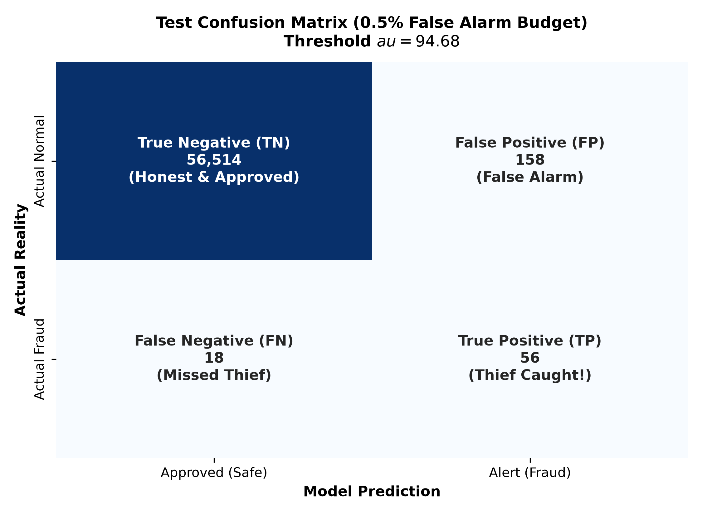

# Card Fraud Triage via Gaussian Mixture Density Scoring and Autoencoder Anomaly Detection


**Team ID:** T047 · **Section:** A · **Project:** 26
**Course areas:** Applied Machine Learning (Phase 1) and Deep Learning (Phase 2)

Can a model that has only ever seen **legitimate** card transactions rank fraudulent ones high enough for a human review queue? This project answers that with unsupervised density-based anomaly detection: a Gaussian Mixture Model (Phase 1) and an autoencoder (Phase 2), evaluated under realistic, time-ordered conditions with fixed false-alarm and analyst-capacity budgets.

---

## Table of contents

1. [Key results](#1-key-results)
2. [Approach](#2-approach)
3. [Dataset](#3-dataset)
4. [Repository structure](#4-repository-structure)
5. [Getting started](#5-getting-started)
6. [Reproducing the results](#6-reproducing-the-results)
7. [Methodology](#7-methodology)
8. [Results in detail](#8-results-in-detail)
9. [Outputs and artefacts](#9-outputs-and-artefacts)
10. [Using the trained model](#10-using-the-trained-model)
11. [Roadmap](#11-roadmap)
12. [Team](#12-team)
13. [References](#13-references)

---

## 1. Key results

Phase 1 champion: **GMM, K = 3 components, full covariance, all 29 features**. It was trained on legitimate transactions only and evaluated once on a held-out future time period.

| Metric (test set, 56,746 transactions, 74 frauds) | Value | 95% bootstrap CI |
| --- | --- | --- |
| Average precision (AP) | **0.612** (random baseline: 0.0013) | 0.485 – 0.743 |
| ROC-AUC | 0.923 | 0.879 – 0.962 |
| Recall at a 0.5% false-alarm budget | **75.7%** (56 of 74 frauds) | 65.8% – 84.7% |
| Realised false-positive rate | 0.28% (158 of 56,672) | — |
| Precision of the top 50 alerts | **84%** (42 of 50) | 70% – 94% |
| Precision of the top 25 / top 100 alerts | 72% / 56% | — |

**Main finding:** GMM fraud-ranking quality depends heavily on which EM solution is reached. The same setting can score anywhere from 0.34 to 0.67 validation AP depending on the random seed. Every configuration is therefore evaluated over 3 seeds and reported with its spread.

The full write-up is in [`reports/Card_Fraud_Triage_Phase1_GMM_Report.docx`](reports/Card_Fraud_Triage_Phase1_GMM_Report.docx).

---

## 2. Approach

```text
creditcard.csv
     │
     ▼
01  Clean & deduplicate ──► chronological split 60 / 20 / 20
     │                         train: legitimate only (fraud removed)
     ▼
02  EDA on training period ──► log(1+Amount), KS feature ranking,
     │                          configs/gmm_features.json
     ▼
03  GMM grid: K = 1–8 × 3 seeds × {all 29, selected 12} features
     │      score = negative log-likelihood, select on validation AP
     ▼
04  Threshold on validation (≤ 0.5% FPR) ──► single test evaluation
                                              + bootstrap CIs
```

| Phase | Model | Anomaly score | Status |
| --- | --- | --- | --- |
| 1 (AML) | Gaussian Mixture Model | Negative log-likelihood under the model of normal spending | Complete |
| 2 (DL) | Autoencoder (+ ablations, optional hybrid with GMM) | Reconstruction error | In progress |

---

## 3. Dataset

[Credit Card Fraud Detection](https://www.kaggle.com/datasets/mlg-ulb/creditcardfraud) (ULB Machine Learning Group), transactions made by European cardholders over two days in September 2013.

| Property | Value |
| --- | --- |
| Transactions | 284,807 (283,726 after removing 1,081 duplicates) |
| Frauds | 492 (0.173%), 473 after deduplication |
| Time span | 48 hours |
| Features | `Time` (seconds since first transaction), `Amount` (EUR), `V1`–`V28` (anonymised PCA components) |
| Label | `Class` (1 = fraud, 0 = legitimate) |
| Missing values | None |

**Chronological split** (notebook 01):

| Split | Time share | Rows | Frauds | Used for |
| --- | --- | --- | --- | --- |
| Train | First 60% | 169,893 | 0 (342 removed) | Fitting the scaler and GMM |
| Validation | Next 20% | 56,745 | 57 | Choosing features, K, seed and threshold |
| Test | Last 20% | 56,746 | 74 | One final evaluation |

> The dataset is not stored in this repository. Download `creditcard.csv` from Kaggle and place it at `data/raw/creditcard.csv`.

---

## 4. Repository structure

```text
aml project/
├── configs/
│   └── gmm_features.json            # 12-feature candidate set (built in notebook 02)
├── data/
│   ├── raw/                         # creditcard.csv (not committed)
│   └── processed/                   # train_legit / val_mixed / test_mixed CSVs (not committed)
├── notebooks/
│   ├── 01_data_inspection_and_split.ipynb
│   ├── 02_eda.ipynb
│   ├── 03_gmm_experiments.ipynb
│   └── 04_gmm_evaluation.ipynb
├── reports/
│   └── Card_Fraud_Triage_Phase1_GMM_Report.docx
├── results/
│   ├── figures/                     # fig1–fig7 PNGs
│   ├── metrics/gmm_test_metrics.json
│   └── models/                      # champion GMM, scaler, feature list (.joblib, not committed)
├── src/                             # reusable modules (Phase 2)
├── requirements.txt
└── README.md
```

---

## 5. Getting started

**Requirements:** Python 3.10+ (developed on 3.13), about 1 GB of free RAM, and a multi-core CPU (notebook 03 runs its fits in parallel).

```bash
git clone <repo-url> && cd "aml project"
```

```bash
python3 -m venv venv
```

```bash
source venv/bin/activate
```

```bash
pip install -r requirements.txt
```

Then download the dataset as described in [Dataset](#3-dataset).

---

## 6. Reproducing the results

Run the notebooks in order. Each one reads the previous one's outputs.

| Step | Notebook | Produces | Approx. runtime |
| --- | --- | --- | --- |
| 1 | `01_data_inspection_and_split.ipynb` | `data/processed/*.csv` | < 30 s |
| 2 | `02_eda.ipynb` | `configs/gmm_features.json`, fig1–fig4 | < 30 s |
| 3 | `03_gmm_experiments.ipynb` | `results/models/*.joblib`, fig5 | ~7 min (8 cores) |
| 4 | `04_gmm_evaluation.ipynb` | `results/metrics/gmm_test_metrics.json`, fig6–fig7 | < 30 s |

To run the whole pipeline headless:

```bash
cd notebooks && for nb in 01_data_inspection_and_split 02_eda 03_gmm_experiments 04_gmm_evaluation; do jupyter nbconvert --to notebook --execute --inplace --ExecutePreprocessor.timeout=-1 "$nb.ipynb"; done
```

All randomness is seeded (`random_state` in each GMM fit, `default_rng(42)` for the bootstrap), so reruns give the same numbers on the same library versions.

---

## 7. Methodology


### Leakage controls

| Risk | Control |
| --- | --- |
| Training on the future | Strict chronological 60/20/20 split |
| Model learning fraud as "normal" | All fraud removed from the training set |
| Scaling leakage | `StandardScaler` fit on training data only |
| Feature selection seeing test labels | KS ranking uses the training period only (notebook 02) |
| Tuning on test | Feature set, K, seed and threshold all chosen on validation; test scored once |

### Model and score

A full-covariance GMM is fit to standardised legitimate transactions (`log(1 + Amount)` plus the V-features). Each transaction is scored by its negative log-likelihood:

$$s(x) = -\log \sum_{k=1}^{K} \pi_k \, \mathcal{N}(x \mid \mu_k, \Sigma_k)$$

A higher score means the transaction is less like the legitimate data.

### Model selection

- **Grid:** K ∈ {1, …, 8} × 2 feature sets (all 29; top-12 by KS statistic) × 3 seeds, each with `n_init=5` EM restarts (144 fits).
- **Fixed settings:** `covariance_type='full'`, `reg_covar=1e-5`, `max_iter=200`.
- **Criterion:** mean validation average precision across seeds. Among that setting's seeds, the fit with the best validation AP is kept.
- AIC and BIC are reported but not used. They keep falling up to K = 8, and for all 29 features BIC turns negative at K ≥ 4 because some components collapse onto near-identical points. High likelihood did not mean good fraud ranking.

### Evaluation

| Scenario | Question | Metric |
| --- | --- | --- |
| A: false-alarm budget | With at most 0.5% false alarms, how much fraud is caught? | Recall at a threshold set on validation |
| B: analyst capacity | If analysts review only the top k alerts, how many are fraud? | Precision@25 / 50 / 100 |
| Overall ranking | How good is the ordering across all thresholds? | Average precision (primary), ROC-AUC |

Accuracy is not reported: a model that always predicts "legitimate" scores 99.8%.

---

## 8. Results in detail


**Validation AP by number of components** (mean, with the min–max range over 3 seeds):

| K | All 29 features | Selected 12 features |
| --- | --- | --- |
| 1 | 0.074 (0.074–0.074) | 0.266 (0.266–0.266) |
| 2 | 0.176 (0.079–0.371) | 0.205 (0.201–0.213) |
| **3** | **0.549 (0.343–0.666)** | 0.201 (0.199–0.205) |
| 4 | 0.068 (0.065–0.074) | 0.197 (0.197–0.198) |
| 5 | 0.300 (0.058–0.647) | 0.203 (0.198–0.212) |
| 6 | 0.068 (0.059–0.078) | 0.334 (0.081–0.628) |
| 7 | 0.196 (0.128–0.232) | 0.067 (0.065–0.069) |
| 8 | 0.323 (0.246–0.419) | 0.075 (0.065–0.095) |

<p align="center">
  
</p>

<p align="center">
  
  
</p>

**Takeaways**

- About three quarters of the test frauds receive clearly anomalous scores, with precision of 0.7–0.85 up to roughly 75% recall. The rest look like ordinary transactions, which caps recall and explains the modest ROC-AUC.
- The selected 12-feature set gives stable but lower AP. The full 29 features reach the best AP at K = 3.
- With only 57 validation and 74 test frauds, all metrics carry wide uncertainty (test AP ±0.13).

---

## 9. Outputs and artefacts


| File | Description |
| --- | --- |
| `results/figures/fig1_time_diurnal_distribution.png` | Hourly volume, normal vs fraud |
| `results/figures/fig2_amount_distribution_log.png` | Raw vs log-transformed amount |
| `results/figures/fig3_top_divergent_features_kde.png` | Densities of the six most separating features |
| `results/figures/fig4_feature_correlation_matrix.png` | Correlation of Hour, Amount and top features |
| `results/figures/fig5_gmm_component_selection.png` | BIC and validation AP vs K |
| `results/figures/fig6_gmm_test_pr_curve.png` | Test precision–recall curve |
| `results/figures/fig7_gmm_test_confusion_matrix.png` | Test confusion matrix at the 0.5% FPR threshold |
| `results/metrics/gmm_test_metrics.json` | All test metrics with confidence intervals |
| `results/models/gmm_champion.joblib` | Fitted champion GMM |
| `results/models/gmm_scaler.joblib` | Scaler fitted on training data |
| `results/models/gmm_features.joblib` | Ordered feature list expected by the scaler |
| `configs/gmm_features.json` | 12-feature candidate set from the training-period KS ranking |

---

## 10. Using the trained model


```python
import joblib
import numpy as np
import pandas as pd

model = joblib.load("results/models/gmm_champion.joblib")
scaler = joblib.load("results/models/gmm_scaler.joblib")
features = joblib.load("results/models/gmm_features.joblib")

THRESHOLD = 94.68  # chosen on validation for <= 0.5% false alarms

df = pd.read_csv("data/processed/test_mixed.csv")
X = df[features].copy()
X["Amount"] = np.log1p(X["Amount"])
scores = -model.score_samples(scaler.transform(X))   # higher = more suspicious

df["anomaly_score"] = scores
df["alert"] = scores >= THRESHOLD
review_queue = df.sort_values("anomaly_score", ascending=False).head(50)
```

---

## 11. Roadmap


- [x] Milestone 1: data inspection, chronological split, leakage-safe preprocessing
- [x] Milestone 2: exploratory analysis and feature ranking on the training period
- [x] Milestone 3: GMM component and feature-set selection over multiple seeds
- [x] Milestone 4: test evaluation under false-alarm and analyst-capacity budgets
- [ ] Phase 2: autoencoder anomaly detection (reconstruction error)
- [ ] Phase 2: ablation studies (architecture, regularisation, input features)
- [ ] Phase 2: hybrid GMM + autoencoder ranking (optional)

---

## 12. Team & Phase 1 Contributions


| Member | Primary Responsibility | Notebook |
| --- | --- | --- |
| **Ritik Ranjan** | Data inspection, deduplication, chronological train/validation/test split, leakage-safe preprocessing | `notebooks/01_data_inspection_and_split.ipynb` |
| **Archit Mamodiya** | Exploratory data analysis, diurnal time patterns, log-amount transformation | `notebooks/02_eda.ipynb` |
| **Shagun Vishnoi** | Feature divergence analysis, KS separation testing, feature correlation heatmap | `notebooks/02_eda.ipynb` |
| **Aditya Raj** | GMM statistical theory, EM fitting, negative log-likelihood scoring, AIC/BIC analysis, model persistence | `notebooks/03_gmm_experiments.ipynb` |
| **Naveen Kumar** | Project integration, operational threshold selection on validation, test evaluation, PR-AUC, confusion matrix, report | `notebooks/04_gmm_evaluation.ipynb` |

---

## 13. References


1. A. Dal Pozzolo, O. Caelen, R. A. Johnson and G. Bontempi. *Calibrating Probability with Undersampling for Unbalanced Classification.* IEEE Symposium on Computational Intelligence and Data Mining (CIDM), 2015.
2. ULB Machine Learning Group. *Credit Card Fraud Detection* dataset. Kaggle. <https://www.kaggle.com/datasets/mlg-ulb/creditcardfraud>
3. C. M. Bishop. *Pattern Recognition and Machine Learning*, ch. 9 (mixture models and EM). Springer, 2006.
4. F. Pedregosa et al. *Scikit-learn: Machine Learning in Python.* JMLR 12, 2011.
